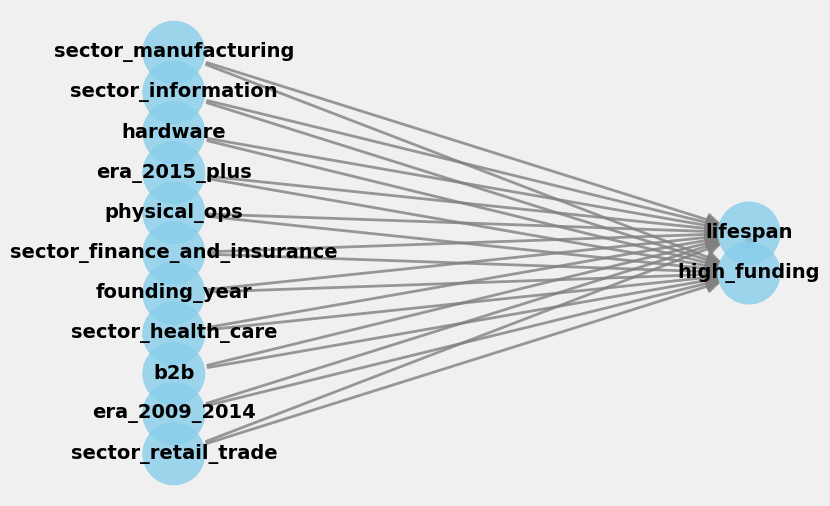
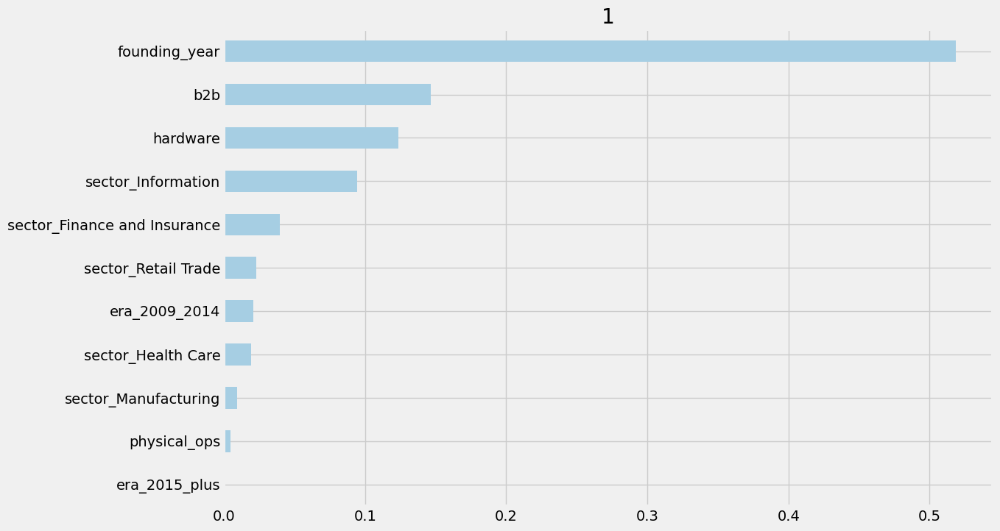
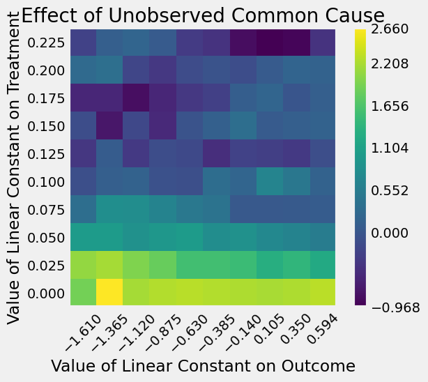

# Causal Inference on Startup Failures

**Author:** Eglantine Dupuy

A causal inference project asking whether funding and competition from "tech giants" actually change how long a startup lasts, using a dataset of failed startups. Built as Assignment 2 for Enterprise Data Science.

## Project overview

- **Dataset:** [*Startup Failures*](https://www.kaggle.com/) (Kaggle, CC BY-NC 4.0) — 356 failed startups across 6 sectors, with sector, years of operation, funding raised, and 13 binary failure-cause flags (e.g. "Giants", "Poor Market Fit", "Monetization Failure").
- **Question 1:** Among startups that eventually failed, does raising more money *cause* them to survive longer?
- **Question 2:** Do startups flagged as having lost to tech giants (e.g. Google, Amazon) have shorter lifespans than comparable startups that didn't?
- **Outcome:** `lifespan` (years of operation).
- **Treatments:** `high_funding` (raised above the $20M median) for Q1; `giants` (lost to a tech giant) for Q2.
- **Confounders:** founding year/era, sector, and business-model flags (`hardware`, `physical_ops`, `b2b`) — all chosen as pre-treatment variables, deliberately excluding the 13 failure-cause flags since those could be *caused by* funding rather than causes of it.

## Data cleaning (`cleaning_causal_inference_startups.ipynb`)

Produces `startups_clean.csv` (356 startups) from 6 raw Kaggle sector files:

- Combined the 6 sector CSVs (409 rows total).
- Fixed a schema mismatch in the Food & Services file (missing 4 flag columns, extra column) by dropping the extra column and filling missing flags with 0.
- Removed 5 startups duplicated across sector files, keeping the first occurrence (403 rows).
- Parsed `founding_year`, `end_year`, and `lifespan` out of a `Years of Operation` column that came in two different text formats.
- Parsed the funding column into `funding_musd` ($ millions), flagging estimated figures and rows where the amount actually belonged to a parent company (e.g. "$0 (Coinbase-funded)").
- Dropped 46 parent-company-product rows and 1 unparseable funding row, leaving **356 startups**.
- Built `high_funding` (treatment), `era`, and business-model flags (`hardware`, `physical_ops`, `b2b`, `consumer_digital`) from keyword rules on company descriptions, manually reviewed and corrected.

## Methodology (`EglantineDupuy_EDS_Assignment2.ipynb`)

1. **Balance checks:** Compared treatment/control groups on confounders before adjustment — high- and low-funded startups differ meaningfully in sector, era, and business model, so a naive comparison would be biased.
2. **CausalML:** Estimated the average treatment effect (ATE) of funding on lifespan with a linear S-learner and an XGBoost T-learner.
3. **DoWhy:** Built an explicit causal graph, identified the backdoor adjustment set, and estimated effects via linear regression and propensity score stratification.
4. **Refutation tests:** Random common cause, placebo treatment, data subset, and unobserved common cause sensitivity analysis, to stress-test both estimates.
5. **Heterogeneous effects:** Explored how the estimated effect of funding varies by business model and era (e.g. larger for B2B startups, inconclusive for hardware).
6. Repeated the identify → estimate → refute pipeline for the second treatment (`giants`).

## Main findings & charts

**The causal graph states the assumptions up front.** Every confounder (founding era, sector, business model) is modeled as affecting both the treatment (`high_funding`) and the outcome (`lifespan`); DoWhy uses this graph to identify a valid backdoor adjustment set before any effect is estimated.

**Funding → lifespan: a real, moderate-sized effect.** The raw gap in average lifespan between high- and low-funded startups is 2.45 years, but high- and low-funded startups differ in sector, era, and business model, so that raw number is biased. After adjusting for confounders, every method agrees on an effect in the 2.0–2.5 year range: 2.21 years (linear regression, 95% CI 1.59–2.82), 2.02 years (XGBoost T-learner), and 2.47 years (propensity score stratification).

**Tech giants → lifespan: no detectable effect.** The adjusted estimate is +0.44 years (95% CI −0.27 to 1.15, p = 0.23) — indistinguishable from zero, and even in the opposite direction from the original hypothesis that losing to a tech giant shortens a startup's life.

**What actually drives the estimated funding effect.** In the XGBoost model, `founding_year` dominates feature importance (~0.52) — more than three times any other feature — meaning the estimated benefit of funding varies mostly with *when* a startup was founded, followed by `b2b` and `hardware` status. This is importance for explaining heterogeneity in the *effect*, not for predicting lifespan itself.

**How fragile is the funding result?** Three refutation tests (random common cause, placebo treatment, 90% data subset) all leave the funding estimate essentially unchanged — evidence it isn't an artifact of the specific model or sample. But a sensitivity analysis for an *unobserved* confounder shows the estimate would fall toward zero (and could even turn negative) if a strong enough hidden factor — e.g. unmeasured founder experience — were tied to both funding and lifespan.

Full writeup, subgroup (heterogeneous effect) results, and an AI-use disclosure are in the main notebook.

## Key limitations

- Every startup in the dataset failed — results describe failed startups only, not startups in general.
- Unmeasured factors (founder experience, team size, location, market size) could confound both estimates.
- Both treatments may partly reflect survival time itself (longer-lived startups have more time to raise more funding or to encounter a tech giant).
- Business-model labels come from keyword rules with manual review; the `Giants` flag was assigned retrospectively from press coverage.
- Subgroup (heterogeneous effect) results are exploratory given the sample size (356 startups).

## Tech stack

Python, pandas, NumPy, statsmodels, [CausalML](https://github.com/uber/causalml) (S/T-learners), [DoWhy](https://github.com/py-why/dowhy) (causal graphs, estimation, refutation), XGBoost.

## Contents

- [`cleaning_causal_inference_startups.ipynb`](./cleaning_causal_inference_startups.ipynb) — raw data cleaning, producing `startups_clean.csv`.
- [`startups_clean.csv`](./startups_clean.csv) — the cleaned, modeling-ready dataset (356 rows).
- [`EglantineDupuy_EDS_Assignment2.ipynb`](./EglantineDupuy_EDS_Assignment2.ipynb) — the full causal inference analysis.
- [`images/`](./images) — charts exported from the notebook, embedded above.

## License note

The underlying "Startup Failures" dataset is distributed under CC BY-NC 4.0 (Kaggle) — non-commercial use with attribution.
